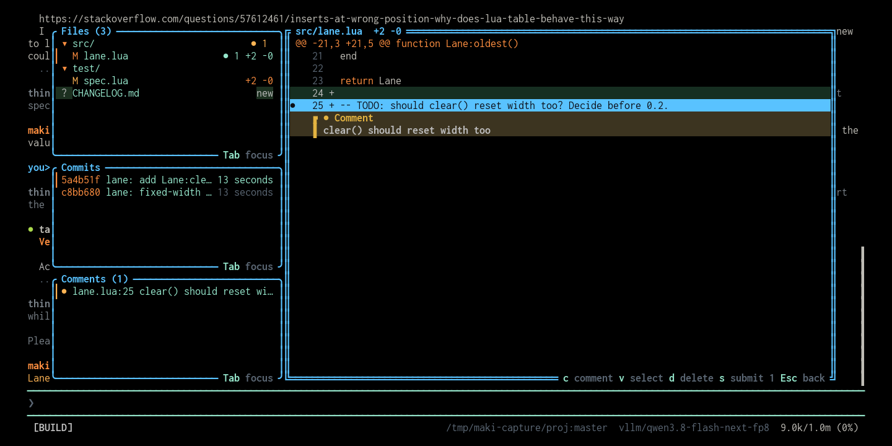

# maki-review

A [maki](https://github.com/tontinton/maki) plugin that adds a `/review` command:
a TUI for reviewing maki's changes, leaving inline comments on diff lines,
and sending them back to a new maki session that fixes them.

Fork of [Asaf51/maki-review](https://github.com/Asaf51/maki-review), the original
`/review` plugin. This copy carries the plugin in maki's package layout, with
`plugin/init.lua` and a `plugin.toml` that states its permissions, so it installs
through `maki.pack.add`. It also repairs the key handling and updates the plugin API
calls. The UTF-8 fix for commit subjects is upstream.




## Features

- **Files** — changed files vs `HEAD` (staged, unstaged, untracked) as a collapsible tree
- **Commits** — recent commits; drill into a commit's files
- **Comments** — every review comment written so far
- **Diff pane** — syntax-highlighted diff with full-row tints; comment a line (`c`),
  select a range first (`v`), delete (`d`)
- **Submit** — `s` sends all comments to a new focused maki session that addresses them
- After each turn, a status flash reminds you when files changed

## Keys

| Key | Action |
| --- | --- |
| `Tab` | cycle left panels |
| `Enter` / `l` | open dir / focus diff / open commit |
| `h` / `Esc` | collapse / back |
| `c` | comment on the current diff line |
| `v` | start range selection |
| `d` | delete comment |
| `s` | submit comments to maki |
| `r` | refresh |
| `q` | quit |

## Install

Install it as a maki package from your `~/.config/maki/init.lua`:

```lua
maki.pack.add({ "https://github.com/g4bwy/maki-review" })
```

Maki asks once to install the package, and once about the permissions its
[`plugin.toml`](plugin.toml) requests: `run` for the git commands that fill the
panels, and `agent` plus `session_write` for `maki.session.new`, which starts the
session that fixes your comments. Accept both and `/review` is available from the
next start. Maki records the installed commit in `pack-lock.json`, and
`/packupdate maki-review` updates it.

To run it from a checkout while you work on it, put it in a package group of your
own. Any group name works except `core`, which maki reserves:

```sh
mkdir -p ~/.local/share/maki/site/pack/dev/start
ln -sfn "$PWD" ~/.local/share/maki/site/pack/dev/start/maki-review
```

Then `/reload`. The plugin code is `plugin/init.lua`, and the package root is the
repository root, which is what `maki.pack.add` clones.
